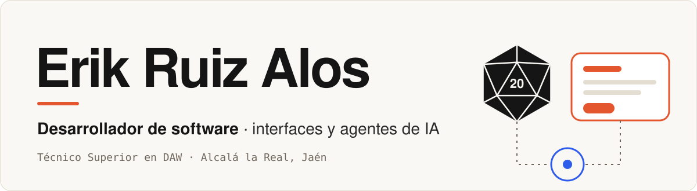
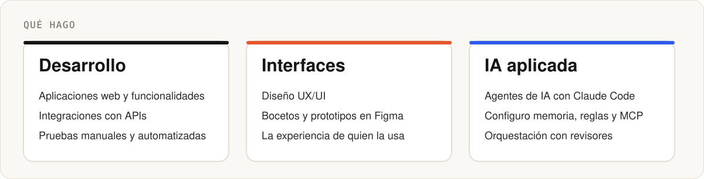

<picture>
  <source media="(prefers-color-scheme: dark)" srcset="assets/cabecera-oscuro.svg">
  
</picture>

 

Soy desarrollador de software y Técnico Superior en Desarrollo de Aplicaciones Web (DAW), titulado en mayo de 2026. Busco un puesto de **desarrollo web, front-end o interfaces**, mejor si va de la mano de la IA, en remoto o presencial en la zona de Granada y Jaén.

<picture>
  <source media="(prefers-color-scheme: dark)" srcset="assets/areas-oscuro.svg">
  
</picture>

### Experiencia

**Desarrollador de software · ISP Gestión** · feb – oct 2026 · prácticas y contrato 
Software SaaS de gestión para operadores de telecomunicaciones.

- En un equipo de 3, plataforma de formación online con Laravel, React y PostgreSQL: diseñé la parte del alumno (UX/UI) con prototipos en Figma, me centré en las pruebas (manuales desde la interfaz, como usuario y con distintos casos, y tests automatizados creados con ayuda de agentes de IA) y participé en las decisiones de autenticación, multi-tenant y base de datos.
- Preparé la configuración de Claude Code con la que el equipo construyó la plataforma: memoria, hooks, skills, reglas y servidores MCP.
- Ya con contrato, sobre el software de gestión (PHP, PostgreSQL y GitLab): integraciones con APIs, desarrollo de nuevas funcionalidades sobre el código existente y corrección y mantenimiento de código.
- Investigación de IA, agentes y herramientas, y agentes internos para cuestionarios, vídeos de formación y optimización de consultas SQL, construidos dirigiendo agentes de IA (Claude Code). Preparé dos cursos de IA para la plantilla.
- Configuración de entornos de desarrollo y ayuda en la configuración de máquinas para clientes.

### Proyectos

**Forja de Héroes** · proyecto propio · desde jul 2026 
Aplicación web de D&D. Hecha con React y agentes de IA (Claude Code). Desplegada.

**Portal B2B para un cliente** · encargo · desde jul 2026, en desarrollo 
Portal de pedidos para un negocio del sector de la automoción, con acceso de clientes y el catálogo de un proveedor. Laravel, Filament y React.

Los repositorios son privados por ahora.

<picture>
  <source media="(prefers-color-scheme: dark)" srcset="assets/trayectoria-oscuro.svg">
  
</picture>

<picture>
  <source media="(prefers-color-scheme: dark)" srcset="assets/stack-oscuro.svg">
  
</picture>
